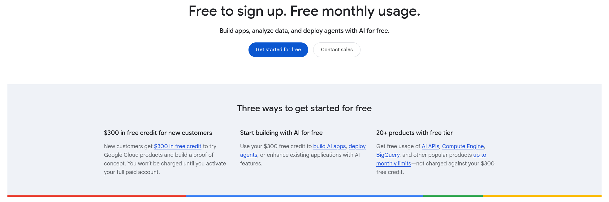

# Gemini 4 Argon in Codex CLI and T3 Code

## First: sign up for Google Cloud

Go to [Google Cloud Free](https://cloud.google.com/free) and click **Get started for free**
to sign up before continuing with the setup below.

**You must be a new Google Cloud customer to qualify for the $300 welcome credit.**
This requirement applies to the free-trial offer; existing customers can use their
eligible paid Google Cloud project for this setup. See the linked page for Google's
current offer and eligibility terms.



## How it works

This fork supports Linux and native Windows. The complete Windows round trip was
verified on 9 November 2026, including tools, streaming and the actual Codex launcher:

```text
codex-argon → LiteLLM (127.0.0.1:4000, Responses API) → Vertex AI (global)
```

Authentication uses your Google account through Application Default Credentials (ADC).
The proxy uses `vertex_ai/gemini-4-argon`. Installation adds a separate `codex-argon`
command and keeps your normal Codex configuration intact.

## Set it up with one prompt

Give an agent with terminal access to the target Linux or Windows computer this prompt:

> Nastav mi podle tohoto repa Argon: https://github.com/triuk/gemini-4-argon-coding-agents
> Používám T3 Code. Přečti AGENTS.md a proveď celý postup v docs/agent-setup.md
> včetně spuštění proxy a ověření. OpenAI chci dál používat vedle Argonu.

The shorter request “Nastav mi podle tohoto repa Argon: [link]” is enough when the agent
can discover the existing T3 installation and Google project. The [agent setup procedure](docs/agent-setup.md)
covers discovery, dependencies, ADC, installation, T3 models, startup and actual API checks.
After verification, the agent asks whether to start the proxy automatically at login and
configures it if you agree. Otherwise, it gives you the manual restart command.
The agent always asks you to complete Google browser sign-in and may need your project
choice or an owner-only billing/IAM action. It reports such blockers explicitly; cloning
the repo alone does not grant access.

T3 Code integration and the three effort choices were verified on 9 November 2026.
Use `setup.sh` on Linux or [`setup.ps1`](setup.ps1) on native Windows. WSL uses the Linux
procedure only when T3's agent actually runs inside WSL. macOS setup is not included.
See the [Windows verification record](docs/windows-verification.md) for versions, checks
and the distinction between local verification and later CI runs.

## Set up another computer

You need Linux or Windows, [uv](https://docs.astral.sh/uv/getting-started/installation/),
[Google Cloud CLI](https://cloud.google.com/sdk/docs/install), and Codex CLI.
On Linux the launcher resolves `codex` through PATH; on Windows setup records the real
executable path as described below. The tested Codex version is 0.166.0, with Code Mode support.
Your Google Cloud project must have billing, Vertex AI enabled, and access to this model.
Your Google account needs permission to use Vertex AI and the project's quota.

Clone this fork:

```bash
git clone https://github.com/triuk/gemini-4-argon-coding-agents.git
cd gemini-4-argon-coding-agents
```

Sign in on the new computer, replacing `your-project-id` below:

```bash
gcloud auth login --update-adc
gcloud services enable aiplatform.googleapis.com --project=your-project-id
gcloud auth application-default set-quota-project your-project-id
```

`gcloud auth login --update-adc` authorizes the CLI and updates the Application Default
Credentials used by the proxy. Follow the browser sign-in even if credentials already exist.
If `GOOGLE_APPLICATION_CREDENTIALS` is set, it overrides these ADC; make sure it points to
the credentials you intend the proxy to use.
See [Google's ADC documentation](https://docs.cloud.google.com/sdk/gcloud/reference/auth/application-default/login).

On Linux, install the proxy and launcher (Windows instructions follow):

```bash
VERTEX_PROJECT=your-project-id ./setup.sh
```

The installer creates an isolated Python 3.12 environment with the verified LiteLLM and
Google Gen AI versions from `requirements.txt`. It writes proxy files under
`~/.config/argon-codex/` and the launcher at `~/.local/bin/codex-argon`.
Add `~/.local/bin` to `PATH` if needed, or use the full launcher path below.
Re-running setup reuses the environment and saves changed files as `<file>.bak-<timestamp>-<pid>`.

## Native Windows installation

Use PowerShell, with T3 Code and Codex running on this Windows machine. Install missing
dependencies using the [official uv instructions](https://docs.astral.sh/uv/getting-started/installation/)
and [Google Cloud CLI instructions](https://docs.cloud.google.com/sdk/docs/install-sdk#windows).
For example, these commands install them without assuming a Linux shell:

```powershell
powershell -NoProfile -ExecutionPolicy Bypass -Command "irm https://astral.sh/uv/install.ps1 | iex"
winget install --id Google.CloudSDK --exact --source winget
```

Do not pass `--scope user` to the Google WinGet package: it may report no applicable installer.
Open a new terminal after installation, or use the installed tools' absolute paths. The
bootstrap also finds uv at `$env:USERPROFILE\.local\bin\uv.exe` if this session's PATH is stale.
Complete the Google sign-in and quota-project commands above before live verification.

From the cloned repository, install for T3 (omit `-T3` for CLI-only use):

```powershell
$env:VERTEX_PROJECT = 'your-project-id'
powershell -NoProfile -ExecutionPolicy Bypass -File .\setup.ps1 -T3
```

The bootstrap obtains Python 3.12 through uv, creates the proxy environment at
`~/.config/argon-codex/.venv`, and installs the pinned dependencies. It compiles
`windows/launcher.cs` locally using Windows' .NET Framework 4.x compiler; no binary is
downloaded from this repository. The installed `~/.local/bin/codex-argon.exe` forwards
arguments, stdio and exit codes without a `cmd.exe` shim. This matters for Codex app-server
and prompts containing quotes, Unicode, percent signs or shell characters.

The installer resolves a real `codex.exe` from the saved installation, the primary T3
instance, PATH, or the OpenAI desktop installation. If needed, specify its absolute path:

```powershell
powershell -NoProfile -ExecutionPolicy Bypass -File .\setup.ps1 -T3 -CodexBinary 'C:\path to\codex.exe' -CodexHome 'C:\path to\.codex'
```

T3's configured Binary path is evidence for this path. An npm `.cmd` shim must be resolved
to its underlying native executable. The real path is stored locally as `codex-binary`;
the launcher works even when T3 has a different PATH. It does not change Codex's global config.
`ARGON_CODEX_BINARY` can override that path for one launch.

Other options are `-T3Settings <absolute-path>`, `-T3Instance <id>`, `-Port 4001` and
`-FilesOnly`. Changed installation files and T3 settings are backed up. Re-running setup
preserves the saved project and port when no override is supplied. `-FilesOnly` skips
proxy dependencies, but the PowerShell bootstrap still needs uv/Python and the C# compiler.

Start the installed proxy manually in the foreground:

```powershell
powershell -NoProfile -ExecutionPolicy Bypass -File "$env:USERPROFILE\.config\argon-codex\start-argon.ps1"
```

Or detach it, append both output streams to `argon.log`, and save its launcher PID in `argon.pid`:

```powershell
powershell -NoProfile -ExecutionPolicy Bypass -File "$env:USERPROFILE\.config\argon-codex\start-argon.ps1" -Background
Invoke-RestMethod http://127.0.0.1:4000/health/liveliness
& "$env:USERPROFILE\.local\bin\codex-argon.exe" exec --ephemeral --skip-git-repo-check 'Reply with the single word OK. Do not use tools.'
```

Allow time for LiteLLM to initialize before checking health. The launcher refuses an occupied
port and leaves its listener alone. To stop a background installation, first verify its saved
PID and process tree, then use `taskkill /PID <verified-pid> /T /F`. Never kill by a broad name.
Background startup uses the environment's GUI interpreter (`pythonw.exe`) with
`CREATE_NO_WINDOW`, bypassing the console-script shim and its console-allocating children.
From the repository, verify the live process tree without billed requests using the
installed interpreter, which does not require Python on PATH:

```powershell
$proxyProcessId = [int](Get-Content "$env:USERPROFILE\.config\argon-codex\argon.pid" -Raw).Trim()
& "$env:USERPROFILE\.config\argon-codex\.venv\Scripts\python.exe" tests/check_windows_console.py --pid $proxyProcessId
```

Restart after reboot with the same command unless automatic login startup was explicitly enabled.
No machine-wide PowerShell execution-policy change, administrator-run proxy or systemd is needed.

## Start and check on Linux

Run the proxy in one terminal:

```bash
~/.config/argon-codex/start-argon.sh
```

Run Codex in another:

```bash
~/.local/bin/codex-argon
```

Or run one short check:

```bash
~/.local/bin/codex-argon exec --ephemeral --skip-git-repo-check 'Reply OK without tools.'
```

The launch overrides select Argon, the local Responses endpoint and low reasoning effort.
They use the same `-c` provider settings as [Codex custom providers](https://learn.chatgpt.com/docs/config-file/config-advanced).
The normal `codex` command keeps using your existing settings. Stop a foreground proxy with
Ctrl+C. Start it again after reboot unless login startup was explicitly enabled.
To keep a log, redirect its output in that terminal:

```bash
~/.config/argon-codex/start-argon.sh > ~/.config/argon-codex/argon.log 2>&1
```

## T3 Code and reasoning effort

Use this command instead of the CLI-only install:

```bash
VERTEX_PROJECT=your-project-id ./setup.sh --t3
```

On Windows use `powershell -NoProfile -ExecutionPolicy Bypass -File .\setup.ps1 -T3` instead.

It creates or updates a separate **Argon proxy** Codex instance and registers
**Gemini 4 Argon** with **Low / Medium / High** effort. The original OpenAI instance,
login and default model stay as they were. Changes to T3 settings are backed up, and
re-running the command keeps a single Argon entry.

After starting the proxy, refresh provider status in T3 and select **Argon proxy →
Gemini 4 Argon** from the thread's model picker. Use **Restart agent session** in the
command palette if an existing conversation retains old metadata. Select the desired
effort beside the model. The launcher's `low` is the fallback; T3's per-turn choice takes
precedence. LiteLLM maps these choices to Gemini's `thinkingLevel`.

The default settings file is `~/.t3/userdata/settings.json` (or under `T3CODE_HOME`).
Use `--t3-settings /path/to/userdata/settings.json` for a different server location,
`--t3-instance my_argon` for a different instance ID, or `--codex-home /path/to/.codex`
to match an existing OpenAI instance's shared home. Compatible Codex instances sharing
that home can continue the same T3 thread. Run setup on the computer hosting the agent.

For manual configuration, add **Codex → Configure manually** in **Settings → Providers**,
set **Binary path** to the absolute installed `codex-argon` path, and use the same
**CODEX_HOME path** as OpenAI. Merge [`codex/t3-model.json`](codex/t3-model.json) as one
entry in `providerInstances.<argon-instance>.config.customModels`. Explicit model
capabilities are necessary: an unregistered model can work while hiding the effort control.
See [T3's Codex guide](https://github.com/pingdotgg/t3code/blob/main/docs/user/providers-codex.md)
and [custom model documentation](https://github.com/pingdotgg/t3code/blob/main/docs/user/composer.md#custom-models).
On Windows the binary is `~/.local/bin/codex-argon.exe`, and the corresponding installer
options use PowerShell names such as `-T3Settings`, `-T3Instance` and `-CodexHome`.

## Why the schema hook is needed

Codex sends tool declarations even when the prompt requests no tool calls. Gemini rejects
some of their JSON Schema constructs. `proxy/argon_hooks.py` adapts these declarations:

- converts `oneOf` to `anyOf`;
- merges root object unions into an object, keeping fields required in every branch;
- replaces enums containing an empty string and empty-string `const` with description hints.

These conversions relax some constraints in the model's declaration. The tool server still
validates the original schema. Messages and tool results pass through unchanged.

## Large T3 tool catalogs

The Argon launcher enables Codex Code Mode (`features.code_mode.enabled` and
`features.code_mode_only`) only for this provider. Tools stay accessible through `exec`
instead of being sent as hundreds of separate function declarations. This avoids the
model's 512-declaration limit without dropping MCP tools or disabling integrations.
The tested Codex version is 0.166.0; use a version supporting these features.

Code Mode's `exec` description includes its entire callable-tool catalog. The schema hook
moves descriptions larger than a conservative 1024-byte declaration budget to Responses
`instructions`, preserving their complete contents and the existing instructions. The
short declaration points to that guidance. This avoids Vertex's description-length limit;
truncating this catalog would make tools undiscoverable. Both `responses` and the actual
LiteLLM proxy route type, `aresponses`, are covered.

Existing Codex app-server processes retain their launch flags. Restart the Argon agent
session/provider after updating the launcher. The normal OpenAI provider keeps its own
settings. Code Mode's feature configuration is described in the
[official Codex reference](https://learn.chatgpt.com/docs/config-file/config-reference).

## Tests

After installing, run the offline regression tests from the repository:

```bash
~/.config/argon-codex/.venv/bin/python -m unittest discover -s tests -v
```

With the proxy running, exercise schema compatibility, a tool round trip and streaming.
This sends three small, billed requests to Vertex AI:

```bash
~/.config/argon-codex/.venv/bin/python tests/test_proxy.py
```

On Windows, run the same tests with the installed environment's `Scripts/python.exe`:

```powershell
& "$env:USERPROFILE\.config\argon-codex\.venv\Scripts\python.exe" -m unittest discover -s tests -v
& "$env:USERPROFILE\.config\argon-codex\.venv\Scripts\python.exe" tests/test_proxy.py --base-url http://127.0.0.1:4000
```

The offline suite selects native installer/process tests on Windows and shell installer
tests on Linux; schema-hook regressions run on both. CI runs both platforms. No Google
credentials are needed by offline tests. Live tests are separate and billed.

Also verify the actual Codex app-server with 530 synthetic echo tools and a call to the
last tool. This exercises Code Mode, the long catalog and a real streaming tool round trip,
and makes billed model requests (the exact number depends on the model's tool use):

```powershell
& "$env:USERPROFILE\.config\argon-codex\.venv\Scripts\python.exe" tests/test_app_server.py --launcher "$env:USERPROFILE\.local\bin\codex-argon.exe" --base-url http://127.0.0.1:4000
```

On Linux use the installed `.venv/bin/python` and `~/.local/bin/codex-argon` paths.
An optional `--t3-event-log <local-log-path>` reuses that thread's MCP configuration in
memory to match T3's tool environment; do not publish this private log or its connection data.
This checker disables provider retries and stops its turn on an error. Report an upstream
429 capacity response as blocked rather than repeatedly running the billed check.

For a parallel trial alongside an existing proxy on port 4000, install with `--port 4001`.
Both launchers read that saved port. `ARGON_PORT` can temporarily override it for one
launch; apply the same override to both commands. The live test accepts
`--base-url http://127.0.0.1:4001`.

## Troubleshooting

| Error | Action |
|---|---|
| `401` or expired credentials | Run `gcloud auth application-default login` again. Check whether `GOOGLE_APPLICATION_CREDENTIALS` overrides your ADC. |
| `403` | Check the selected project's billing, Vertex AI API and account permissions. |
| `404` for the model | Check model access; this setup uses the `global` endpoint. |
| `429 Resource exhausted` | Retry later or inspect the project's quota/capacity. A running proxy cannot resolve an upstream capacity limit. |
| `400` naming a tool schema | Check that the installed hook matches the repo, then restart the proxy. |
| Port 4000 already in use | Reuse a verified compatible proxy, or install with `--port 4001`. |
| Effort selector missing in T3 | Re-run `./setup.sh --t3` or `setup.ps1 -T3`, refresh provider status, then restart the agent session. |
| Windows cannot find Codex | Use `setup.ps1 -CodexBinary <absolute-codex.exe-path>`; resolve npm `.cmd` shims to the underlying executable. |
| PowerShell script execution is disabled | Use the documented `powershell -NoProfile -ExecutionPolicy Bypass -File ...` command for this process. |
| Windows launcher cannot be replaced | Stop only the Argon instance using it, then rerun setup; a running `.exe` can be locked. |
| `At most 512 function declarations` | Update/reinstall the launcher with Code Mode enabled and restart the Argon provider/session. Run the 530-tool app-server check above. |
| `function_declarations[0].description` too long | Check the installed hook's description relocation on `aresponses`, then restart this proxy. |
| Empty black `litellm.exe` window at login | Update the Windows runtime. Background startup uses `pythonw.exe` and `CREATE_NO_WINDOW` instead of the console-script shim; restart this installation's verified process. |

## Files and removal

`setup.sh --files-only` writes files without installing dependencies or starting anything.
`ARGON_CONFIG_DIR` and `ARGON_BIN_DIR` can override the installation directories;
`XDG_CONFIG_HOME` is respected for the default config directory.
On Linux, when using a custom `ARGON_CONFIG_DIR` with T3, set that variable in the instance's
environment too. On Windows the generated native launcher records its installation directory,
so this extra variable is unnecessary unless intentionally overriding the installed directory.
The Git attributes keep shell scripts at LF even with Windows `core.autocrlf` enabled.
There are no embedded credentials, machine-specific paths or Google project IDs in the repo.
To remove the installation, stop its proxy and remove `~/.config/argon-codex/` and
`~/.local/bin/codex-argon`. Remove its T3 provider instance if you used `--t3`.
On Windows remove `~/.local/bin/codex-argon.exe` and any explicitly enabled per-user startup
entry as well. `setup.ps1 -FilesOnly` is the Windows equivalent of `setup.sh --files-only`.
To undo a later file update, restore its adjacent `.bak-*` copy.

Based on [Itsme23476/gemini-4-argon-coding-agents](https://github.com/Itsme23476/gemini-4-argon-coding-agents).
